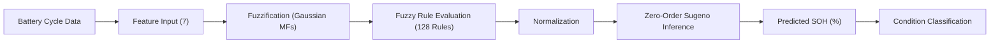

# SMART EV BATTERY MANAGEMENT SYSTEM

> **ANFIS-Based Battery State of Health Estimation**  
> *Soft Computing & AIML Engineering Project*

---

## 1. Project Overview

The **Smart EV Battery Management System (BMS)** is a professional engineering dashboard and soft computing application designed to accurately estimate the **State of Health (SOH)** of Electric Vehicle lithium-ion battery packs using an **Adaptive Neuro-Fuzzy Inference System (ANFIS)**.

The system processes **seven electrochemical charging and discharging cycle parameters** extracted from operational cell dynamics. Using Gaussian membership functions, 128 evaluated fuzzy rules, and zero-order Sugeno inference, it deterministically computes the battery SOH percentage and classifies cell degradation state into **HEALTHY**, **WARNING**, or **CRITICAL** conditions according to project-defined evaluation benchmarks.



---

## 2. Core ANFIS Architecture

| Component | Technical Specification |
|---|---|
| **Model Architecture** | Adaptive Neuro-Fuzzy Inference System (ANFIS V5) |
| **Inference Mechanism** | Zero-Order Sugeno Fuzzy Model |
| **Task / Output** | Battery State of Health (SOH %) — Regression |
| **Number of Inputs** | 7 Electrochemical Cycle Parameters |
| **Membership Functions** | 2 Gaussian MFs per input ($\mu(x) = \exp(-0.5 \cdot ((x-c)/\sigma)^2)$) |
| **Rule Base Matrix** | $2^7 = 128$ Takagi-Sugeno Fuzzy Rules |
| **Input Scaling** | Scikit-learn `MinMaxScaler` ($[0, 1]$ normalization) |
| **Target Scaling** | Inverse `MinMaxScaler` mapping model output to SOH % |
| **Inference Source** | Offline-trained model weights (`anfis_v5_model.npz`) |

---

## 3. Seven Battery Cycle Input Parameters

The ANFIS model requires exactly seven cycle features extracted from battery cycling profiles:

1. **Charging Voltage Time (`tv_ch`)** `[s]` — Time elapsed during charging voltage phase.
2. **Discharging Voltage Time (`tv_d`)** `[s]` — Duration of discharge voltage plateau.
3. **Charging Current Time (`tI_ch`)** `[s]` — Constant current charge duration.
4. **Average Battery Temperature (`Tavg`)** `[°C]` — Mean thermal reading across the complete cycle.
5. **Time to Peak Temperature (`tTpeak_ch`)** `[s]` — Time to reach maximum cell temperature during charge.
6. **Average Charging Voltage (`Eavg_ch`)** `[V]` — Mean cell/pack potential during charging.
7. **Average Discharging Voltage (`Eavg_d`)** `[V]` — Mean cell/pack potential during discharging.

---

## 4. Battery Health Classification Thresholds

The predicted State of Health is classified using project-defined demonstration thresholds:

- **HEALTHY (`SOH ≥ 90.0%`)**: Optimal capacity retention, nominal internal impedance, minimal degradation.
- **WARNING (`85.0% ≤ SOH < 90.0%`)**: Moderate capacity fade and thermal impedance rise. Increased cycle monitoring advised.
- **CRITICAL (`SOH < 85.0%`)**: Substantial capacity decay below project safety threshold. Diagnostic inspection recommended.

*Note: These benchmarks are project-defined demonstration criteria for academic evaluation.*

---

## 5. Verified Demonstration Presets

The dashboard includes one-click presets populated directly from the project's processed dataset (`final_anfis_dataset.csv`):

| Preset | Dataset Origin | SOH Prediction | Condition |
|---|---|---|---|
| **Healthy Example** | Global Cycle 1 | **97.45%** | `HEALTHY` |
| **Warning Example** | Global Cycle 180 | **87.50%** | `WARNING` |
| **Critical Example** | Global Cycle 305 | **84.52%** | `CRITICAL` |

---

## 6. How to Run the Application

### Prerequisites
- Python 3.10+ (tested on Python 3.14)
- Packages installed from `requirements.txt`:
  ```bash
  pip install -r requirements.txt
  ```

### Launch Native Desktop Dashboard
Run the batch file or python script:
```bash
run.bat
```
or directly:
```bash
python app.py
```

### Launch Web Browser Mode
```bash
python app.py --web
```

---

## 7. Technology Stack

- **Python 3.14**: Runtime environment
- **Flet 1.0.0**: Reactive GUI framework configured with Dark Engineering Theme
- **NumPy**: Matrix computation for Gaussian MFs and 128-rule inference
- **Scikit-Learn & Joblib**: Feature and SOH MinMaxScaler pipelines
- **Pandas**: Tabular dataset processing and verification
